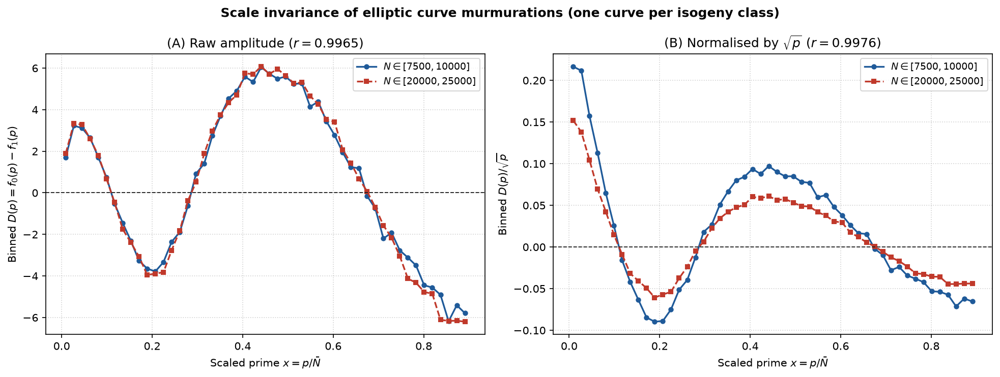
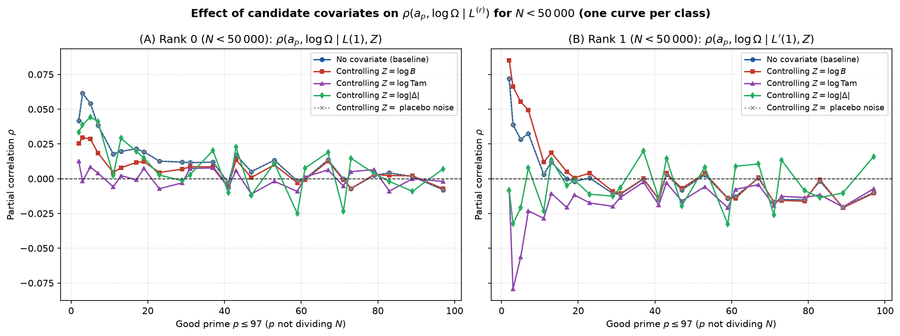
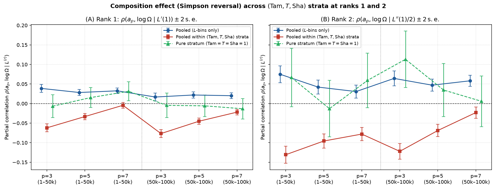
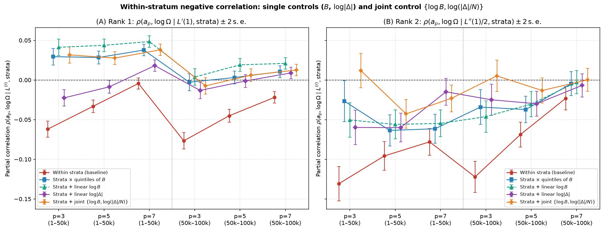

**Notation.** For $E/\mathbb{Q}$ of conductor $N$ and analytic rank $r$:

- $a_p$ is the Frobenius trace at a good prime $p$.
- $L^{(r)} := L^{(r)}(E,1)/r!$.
- $\Omega$ is the real period, including the number of real components.
- $R$ is the regulator.
- $T := |E(\mathbb{Q})_{\mathrm{tors}}|$.
- $\mathrm{Tam} := \prod_{q\mid N} c_q$ is the Tamagawa product. Bad primes are always written $q$.
- $\mathrm{Sha}$ is the analytic order of the Tate–Shafarevich group as tabulated by Cremona.

# Abstract

Recent preprints by Wachs report that, among elliptic curves over $\mathbb{Q}$, the traces $a_p$ at small primes correlate with Birch–Swinnerton-Dyer (BSD) invariants. In their October 2026 versions, the main claim still standing is a positive partial correlation between $a_p$ and $\Omega$ at fixed $L(E,1)$, at rank 0.

We re-examine this on the 437 226 isogeny classes with $N<10^5$ in Cremona's tables. We use one curve per class, permutation nulls conditioned within quantile bins, strata of the discrete invariants, separate discovery and confirmation conductor windows, and predictions written down before each analysis. We find the following.

(i) The correlation replicates at rank 0: $\rho(a_3,\Omega\mid L) = +0.049 \pm 0.006$ for $N<5\cdot10^4$. It also appears at rank 1 in the discovery window, though more weakly in the confirmation window.

(ii) At rank 0, the BSD identity routes it through the Tamagawa channel. There, fixing $L(1)$ reverses the sign of the $a_p$–$\mathrm{Tam}$ association, from $+0.079$ to $-0.104$ at $p=3$. The Euler factor at bad primes, $B$, behaves like a collider. Among curves with trivial torsion, binning on $B$ absorbs 79–94% of the $a_p$–$\mathrm{Tam}$ coupling at rank 0, and 69–83% at rank 1.

(iii) At ranks 1 and 2, the positive correlation reverses sign inside strata of $(\mathrm{Tam}, T, \mathrm{Sha})$ in 12 of 12 cases. This is a composition (Simpson) effect.

(iv) The negative within-stratum correlation comes from two sources. One is a collider effect of $B$, cleanest at rank 1 in the narrower conductor window. The other is a coupling of $a_p$ to the discriminant excess $\log(|\Delta|/N)$ that exists without fixing $L$, mainly at rank 2. Controlling both brings all six confirmation cases to $|\rho| \le 0.014$, five of them compatible with zero. It does not fully work in the wide discovery window.

We conclude that the period–trace correlation is explained by BSD bookkeeping, conditioning and composition, rather than by a direct link between Frobenius traces and the real period. We also report an error in the file-format documentation of Cremona's tables (now reported upstream), a null result for $\mathrm{Sha}$-stratified trace profiles at rank 1, and several open regularities. Nothing here bears on a proof of the BSD conjecture.

# 1. Introduction

He, Lee, Oliver and Pozdnyakov [HLOP] discovered *murmurations*: averages of $a_p$ over curves of fixed rank oscillate as a function of $p/N$. Zubrilina [Z] and Bober–Booker–Lee–Lowry-Duda [BBLL] proved murmuration densities for modular forms, including the scale invariance in $p/N$. D. Wachs [W1, W2] asked whether trace profiles also depend on the other BSD invariants.

**What [W1, W2] already corrected (October 2026 versions):**

- The claim that $\mathrm{Sha}$ carries information about $a_p$ at rank 0. There $\mathrm{Sha} = L(1)T^2/(\Omega\,\mathrm{Tam})$ by definition, so it is withdrawn.
- The sign flip at $p=3$, which was an artefact of decile conditioning.
- The "100% Tamagawa channel", which follows from the BSD formula.
- A limit theorem for the covariance between $a_p$ and the period, which is withdrawn.

**What [W2] retains:** a positive partial correlation $\rho(a_p,\Omega\mid L)$ at small $p$ and rank 0, for example $+0.062\pm0.004$ at $p=3$ using all curves. Positive rank over $\mathbb{Q}$ and the number of real components were not studied.

**What this note adds.**

1. An audit of the retained correlation with one curve per isogeny class. This matters because $a_p$ is an isogeny invariant, while $\mathrm{Sha}$, $\Omega$, $\mathrm{Tam}$ and $T$ vary within a class.
2. A quantitative mechanism at rank 0: the bad-prime Euler factor $B$ acts as a collider.
3. The extension to ranks 1 and 2, where the correlation is a composition effect.
4. The separation of a collider regime from an unconditional coupling to the discriminant excess.
5. Side results (Section 6).

All analyses use separate discovery and confirmation conductor windows, and the main predictions were written down before running each analysis.

# 2. Data and methods

**Data.** We use Cremona's files `allbsd`, `allcurves` and `allgens` for $N \le 99\,999$ [C], downloaded in November 2026: 657 396 curves in 437 226 isogeny classes. Curve number 1 of each class (the $\Gamma_0(N)$-optimal curve) represents the class. Ranks 0, 1, 2 and 3 have 168 760, 222 439, 45 496 and 531 classes. Counts per block of $10^4$ conductors match Cremona's published table exactly.

**Recomputation with PARI/GP 2.19.1** [P], on 1 020 curves (1 000 at random and 20 of rank 3):

- Rank, torsion and Tamagawa product agree in 100% of cases.
- $L^{(r)}$, $\Omega$ and $R$ agree to relative error below $5\cdot10^{-15}$.
- $(-1)^r$ equals the root number in every case.
- $\mathrm{Sha}$, computed from PARI values only, lies within $3.6\cdot10^{-15}$ of a perfect square.
- Conventions: Cremona's `CP` column is `ellglobalred(E)[3]`, and PARI's `elltamagawa` includes the archimedean factor. $\Omega$ is `E.omega[1]` times the number of real components.

**Documentation error.** `docs/file-format.txt` in the `ecdata` repository describes `allgens` as `ID AI R TOR TGENS GENS`, but the files list the free generators first. In the line `65 a 2 [1,0,0,4,1] 1 [2] [1:2:1] [-2:1:8]`, the point $(1,2)$ has canonical height $0.187757049\ldots$ (the tabulated regulator), and $(-1/4,1/8)$ has order 2. We checked 2 000 random lines among the 181 307 with $r\ge1$ and $T>1$ (27.6% of curves). In all of them the points right after `TOR` have infinite order and the remaining ones are torsion. Reported as [C2].

**Traces and windows.**

- $a_p$ is computed with PARI for the first 25 primes ($p\le97$), on curve 1 of each class. For each $p$, only classes with $p\nmid N$ are used.
- The **discovery** window is $N<5\cdot10^4$ and the **confirmation** window is $5\cdot10^4\le N<10^5$.
- Section 4 uses $[10^4, 5\cdot10^4]$ instead of the first window.

**Partial correlations.**

- $\rho(x,y\mid\mathcal{B})$: subtract within-bin means from $x$ and $y$, then take the Pearson correlation of the residuals. Standard error $1/\sqrt{n-|\mathcal{B}|-1}$.
- With continuous covariates $Z$: also subtract within-bin means from the columns of $Z$, regress the residuals of $x$ and $y$ on them by least squares, and correlate what remains. Standard error $1/\sqrt{n-|\mathcal{B}|-\dim Z-1}$.
- $L$-bins are 100 quantiles of $L^{(r)}$.
  - In Sections 5.1–5.2 they are computed on the whole (rank, window) sample *before* restricting to $p\nmid N$.
  - In Sections 5.3–5.4 they are computed *after* that restriction.
  - The choice changes the reported correlations by at most 0.002.

**Strata.**

- Classes of $\mathrm{Tam} \in \{1,2,3,4,5\text{–}8,\ge9\}$, $T\in\{1,2,3,\ge4\}$ and $\mathrm{Sha}\in\{1,\ge4\}$.
- Inside each stratum with at least 200 classes, $L$-quantile bins with $q=\min(100,\lfloor n/50\rfloor)$ bins.
- The two top Tamagawa classes are **grouped**, so $\mathrm{Tam}$ still varies inside them. We report sensitivity to *integer-exact* strata (each integer value its own stratum) where it matters.
- "Pure stratum" means $\mathrm{Tam}=T=\mathrm{Sha}=1$.

**Permutation nulls** use 1 000 shuffles within the conditioning bins.

**Bad-prime Euler factor:** $B=\prod_{q\mid N}(1-a_q/q)^{-1}$, with $a_q=+1,-1,0$ for split multiplicative, non-split multiplicative and additive reduction.

**Exact decomposition.** The identity $\log\Omega=\log L^{(r)}-\log R-\log\mathrm{Tam}-\log\mathrm{Sha}+2\log T$ splits within-bin covariances exactly, with numerical error $\le 2\cdot10^{-16}$.

**Caveat.** $\mathrm{Sha}$ in the tables assumes BSD. We use it only as a stratification variable.

# 3. Calibration

- **Average rank.** By class, it rises from 0.619 ($N<10^4$) to 0.752 ($9\cdot10^4\le N<10^5$). The share of rank 2 goes from 5.2% to 12.4%, as described in [BMSW].
- **Murmurations, counts.** For $N\in[7500,10000]$ we recover HLOP's counts: 4 328 classes of rank 0 and 5 194 of rank 1.
- **Murmurations, signal.** With $D=f_0-f_1$ over the first 1 000 primes, $S=\sqrt{\overline{D^2}}=3.807$, against $1.252\pm0.040$ under 100 label shuffles ($z=63$).
- **Scale invariance.** In the held-out window $[20000,25000]$, the binned $D$ as a function of $x=p/\bar N$ matches the first window with correlation 0.9965, in raw amplitude (Figure 1). This scale invariance is known [Z, BBLL]; we use it only as a pipeline check.

*Figure 1. Murmurations: $D(p)=f_0(p)-f_1(p)$ averaged in 50 bins of $x=p/\bar N$, for $N\in[7500,10000]$ and $[20000,25000]$. (A) Raw. (B) Divided by $\sqrt p$.*

# 4. Sha-stratified trace profiles

We compare $\mathrm{Sha}\ge4$ against $\mathrm{Sha}=1$ (curve 1), using the RMS over $p\le97$ of the difference in mean $a_p$.

**Rank 0, $N\in[10^4,5\cdot10^4]$** (62 202 vs 6 120 classes).

- $\mathrm{RMS}=0.561$, against $0.087\pm0.015$ for unconditioned shuffles.
- Shuffling within 100 $L$-bins gives $0.334\pm0.010$, so $L(1)$ accounts for a large share. The observed RMS still exceeds every null ($p=1/1001$).
- The residual is concentrated at small primes. For $3\le p\le 23$, $z$ is between 4.7 and 10.5 in this window. In the confirmation window it reaches 12.6 ($p=5$). At $p=2$ it is not significant in this window ($z=1.7$).
- No bivariate control ($L\times$ deciles of $N$, $\Omega$, $\mathrm{Tam}$ or $T$) removes it, and everything replicates in $[5\cdot10^4,10^5)$.
- In line with [W1]: at fixed $L$, $\mathrm{Sha}\ge4$ selects small $\Omega\,\mathrm{Tam}/T^2$, so this is not information about $\mathrm{Sha}$ "itself".

**Rank 1.** $\mathrm{Sha}\ge4$ on curve 1 is rare: 53 and 204 classes in the two windows.

- Unconditioned permutation p-values are 0.008 and 0.28. The first is driven by one prime ($p=79$, $z=-3.8$).
- Labelling classes by the *maximum* $\mathrm{Sha}$ in the class (762 and 1 405 classes) gives L-conditioned p-values of 0.79 and 0.48.

**Power.** We measure power by injecting a signal into the rank-1 shuffles and recomputing the statistic.

- **Signal.** The injected signal is the rank-0 residual *beyond* the $L$-conditioned null mean, $r_0(p)=\Delta_{\mathrm{obs}}(p)-\mathbb{E}_{\mathrm{null}}[\Delta(p)]$, taken from the same window and labelling. Its RMS is 0.13–0.27.
- **Why not quadrature.** Naive quadrature $\sqrt{\mathrm{RMS}_{\mathrm{obs}}^2-\mu_{\mathrm{null}}^2}$ roughly doubles this RMS, because $r_0$ is strongly aligned with the null mean vector ($\cos\approx0.6$–$0.9$).

*Table 1.* Mean excess of the injected statistic over the rank-1 null, and power at $\alpha=0.05$.

| Labelling | Discovery window | Confirmation window |
|---|---|---|
| Curve 1 | $0.4\sigma$ (power 9%) | $1.4\sigma$ (power 37%) |
| Class maximum | $0.9\sigma$ (power 20%) | $2.8\sigma$ (power 91%) |

Values come from 5 000 shuffles, and 10 000 for the class-maximum confirmation case, which gives $2.82\sigma$ and power 91%. An independent re-run of that case with fewer shuffles gave $3.0\sigma$ and power 0.96.

**Conclusion.** The curve-1 test has little power. The class-maximum test in the confirmation window has high power at $\alpha=0.05$ against a rank-1 effect as large as the rank-0 residual *and of the same sign*, and finds none ($p=0.48$). This is moderate evidence against such an effect. Against a signal of the opposite sign, the power is only 21% ($0.9\sigma$), because $r_0$ is partly aligned with the rank-1 null mean.

# 5. The period–trace correlation

## 5.1 Replication, and a refuted hypothesis

With one curve per class and 100 $L$-bins:

- **Rank 0, $p=3$:** $\rho(a_3,\Omega\mid L)=+0.049\pm0.006$ (discovery) and $+0.036\pm0.006$ (confirmation). [W2] reports $+0.062\pm0.004$ on all curves.
- **Rank 1, given $L'(1)$, discovery window:** $p=2$ gives $+0.082\pm0.006$ and $p=3$ gives $+0.054\pm0.005$.
- **Rank 1, confirmation window:** these fall to $+0.015\pm0.007$ and $+0.020\pm0.005$.

**A refuted hypothesis.** We recorded in advance that the effect might come from the number of real components $c_\infty\in\{1,2\}$ ($c_\infty=2$ exactly when $\Delta>0$), through $\mathrm{sign}(\Delta)$ and $(\Delta/p)$ at $p\equiv3\pmod 4$. At rank 0, $p=3$, discovery window:

- Controlling $\mathrm{sign}(\Delta)$ gives $+0.0505$.
- Replacing $\Omega$ by $\Omega/c_\infty$ gives $+0.0472$.
- There is no mod-4 pattern: $\rho_5=+0.040$.
- At fixed $L$, the sign of $\Delta$ does not shift $a_3$ ($z=+0.25$).

The hypothesis is refuted.

## 5.2 Rank 0: the Tamagawa channel and a collider

The baselines in $\log\Omega$ are $\rho(a_3,\log\Omega\mid L)=+0.061$ (discovery) and $+0.053$ (confirmation). By the exact decomposition, for $p\in\{3,5,7\}$ and both windows:

- the Tamagawa channel $-\mathrm{Cov}(a_p,\log\mathrm{Tam}\mid L)$ contributes between $+165\%$ and $+263\%$ of $\mathrm{Cov}(a_p,\log\Omega\mid L)$;
- the Sha channel offsets it by between $-30\%$ and $-120\%$;
- the torsion channel offsets it by between $-23\%$ and $-60\%$.

**Proposed mechanism.** $L(1)$ behaves heuristically like a product of local factors. The good-prime factors $p/\#E(\mathbb{F}_p)$ increase with $a_p$. $B$ is large under split multiplicative reduction, which is exactly when $c_q$ can be large. Fixing the product forces these two parts to compete: a collider.

**Evidence:**

- **Coupling.** $\rho(a_3,\log B\mid L)=-0.317$ (rank 0, discovery window).
- **$\log B$ as a covariate.** It lowers $\rho(a_p,\log\Omega\mid L)$ by 47–89%, across $p\in\{3,5,7\}$ and both windows (for $p=3$, discovery: $+0.061\to+0.030$). A placebo covariate lowers it by 0%. $\log|\Delta|$ changes it by between $-37\%$ and $+7\%$.
- **Bins of $B$.** Among classes with $T=1$, adding deciles of $B$ to the $L$-bins absorbs 79–94% of $|\rho(a_p,\log\mathrm{Tam}\mid L)|$ at rank 0, and 69–83% at rank 1, for $p\in\{3,5,7\}$ and both windows.
- **Alternatives.** $(\Delta/p)$ absorbs at most 6.3%, and the full state of 2-torsion mod $p$ at most 4.6%.

**Unconditioned baseline** (rank 0, $p=3$, discovery window).

- At fixed $N$ only, $\rho(a_3,\log\Omega)=+0.143$. This is larger than at fixed $L$, because $a_p$ pushes $L(1)$, which carries $\Omega$.
- What fixing $L$ does is reverse the $a_3$–$\mathrm{Tam}$ association, from $+0.079$ to $-0.104$. This reversal is the collider signature.

*Figure 2. $\rho(a_p,\log\Omega\mid L, Z)$ against $p\le97$, discovery window, for covariates $Z\in\{\emptyset,\log B,\log\mathrm{Tam},\log|\Delta|,\text{placebo}\}$. (A) Rank 0. (B) Rank 1.*

## 5.3 Ranks 1 and 2: a Simpson reversal

**The reversal.** Within strata, with $L$-bins inside each stratum, the correlation reverses sign in all 12 cases (ranks 1 and 2, $p=3,5,7$, both windows).

*Table 2.* $\rho(a_3,\log\Omega\mid L)$, pooled and within strata.

| Rank | Window | Pooled | Within strata | Within integer-exact strata |
|---|---|---|---|---|
| 1 | discovery | $+0.039$ | $-0.062$ | $-0.072$ |
| 1 | confirmation | $+0.017$ | $-0.077$ | $-0.086$ |
| 2 | discovery | $+0.075$ | $-0.131$ | $-0.116$ |
| 2 | confirmation | $+0.064$ | $-0.122$ | $-0.126$ |

In the pure stratum at rank 1, $\rho(a_3,\log\Omega\mid L')$ is $-0.007\pm0.015$ (discovery) and $-0.005\pm0.016$ (confirmation). See Figure 3.

**Allocation without fixing $L$.** In the pure stratum at fixed conductor, for ranks 1 and 2 and $p\in\{2,3,5\}$ (pre-registered primes):

- 83–132% of $\mathrm{Cov}(a_p,\log L^{(r)})$ goes to $\log R$.
- The share going to $\log\Omega$ is smaller and of varying sign, between $-32\%$ and $+17\%$.
- At $p=7$, which was not pre-registered, the share to $\log R$ is 47–127% and the share to $\log\Omega$ ranges from $-27\%$ to $+53\%$.

So the traces mainly move $L^{(r)}$ through the regulator, not through the period.

*Figure 3. Pooled $\rho(a_p,\log\Omega\mid L)$ (blue), pooled within strata (red), and pure stratum (green), with $\pm2$ s.e. (A) Rank 1. (B) Rank 2.*

## 5.4 The negative within-stratum correlation

Table 3 lists, within strata, the correlation without fixing $L$, with $L$, and with $L$ plus the joint control $\{\log B,\log(|\Delta|/N)\}$, which was specified in advance.

*Table 3.* $\rho(a_p,\log\Omega\mid\text{strata},\cdot)$. Standard errors are about 0.004–0.005 for rank 1 and about 0.007–0.011 for rank 2.

| Rank | Window | $p$ | Without $L$ | With $L$ | With $L$ + joint control |
|---|---|---|---|---|---|
| 1 | discovery | 3 | $-0.065$ | $-0.062$ | $+0.032$ |
| 1 | discovery | 5 | $-0.035$ | $-0.033$ | $+0.028$ |
| 1 | discovery | 7 | $-0.008$ | $-0.004$ | $+0.038$ |
| 1 | confirmation | 3 | $-0.015$ | $-0.077$ | $-0.007$ |
| 1 | confirmation | 5 | $+0.007$ | $-0.045$ | $+0.006$ |
| 1 | confirmation | 7 | $+0.011$ | $-0.022$ | $+0.013$ |
| 2 | discovery | 3 | $-0.182$ | $-0.131$ | $+0.012$ |
| 2 | discovery | 5 | $-0.129$ | $-0.096$ | $-0.043$ |
| 2 | discovery | 7 | $-0.093$ | $-0.078$ | $-0.023$ |
| 2 | confirmation | 3 | $-0.114$ | $-0.122$ | $+0.005$ |
| 2 | confirmation | 5 | $-0.066$ | $-0.069$ | $-0.013$ |
| 2 | confirmation | 7 | $-0.022$ | $-0.023$ | $+0.000$ |

**Rank 1, confirmation window.**

- The negative correlation is created by fixing $L'(1)$.
- Adding quintiles of $B$ to the strata gives $-0.003$, $+0.003$ and $+0.010$ for $p=3,5,7$. Cutting the quintiles after filtering $p\nmid N$ gives $-0.008$ at $p=3$.
- Both links of the collider hold within strata in all 12 cases (both ranks and both windows): $\rho(a_p,\log B\mid L)$ is between $-0.13$ and $-0.46$, and $\rho(\log B,\log\Omega\mid L)$ is between $+0.14$ and $+0.26$.

**Rank 1, discovery window.**

- The negative correlation already exists without fixing $L$.
- $B$ and the joint control overshoot to positive values.
- This window spans $11\le N<5\cdot10^4$, more than three orders of magnitude, which linear covariates do not capture well.

**Rank 2.**

- The negative correlation exists without fixing $L''(1)/2$, so it is mainly an unconditional coupling. It is not created by conditioning.
- Once $L''(1)/2$ is fixed, $\log B$ still lowers it by 62% ($p=3$, confirmation: $-0.122\to-0.046$). So there is also a collider contribution.
- A passive proxy of $\Omega$ correlated at $|r|=0.83$–$0.88$ could remove at most 44–45% (rank 1) or 49–52% (rank 2). $\log|\Delta|$ removes more than that in 10 of 12 cases. So $a_p$ is coupled to $|\Delta|$ beyond $\Omega$, and the excess $\log(|\Delta|/N)$ carries it.
- Crossing strata with quintiles of $B$ drops 7–29% of the rank-2 sample (19–29% at $p=3$), because of the minimum stratum size of 200. We therefore also report linear controls.

**What links $B$ to $|\Delta|$** (all cases). The split/non-split mix of reduction types explains only part of the association between $\log B$ and $\log|\Delta|$:

- at rank 1, 19–27% with our strata and 12–17% with integer-exact strata;
- at rank 2, none (between $-17\%$ and $-2\%$).

Most of it is carried by the size of the bad primes.

**Summary.** In the confirmation window the joint control brings all six cases to $|\rho|\le0.014$. Five are compatible with zero ($|z|\le1.7$); rank 1, $p=7$, overshoots to $+0.013$ ($z\approx3.5$). In the discovery window it overshoots at rank 1 and leaves $-0.043$ ($z\approx-4.7$) at rank 2, $p=5$. Figure 4 shows the single-covariate controls and the joint control.

*Figure 4. Within-strata $\rho(a_p,\log\Omega\mid L,\text{stratum})$, $\pm2$ s.e.: baseline, with quintiles of $B$, with linear $\log B$, with linear $\log|\Delta|$, and with the joint control $\{\log B,\log(|\Delta|/N)\}$. (A) Rank 1. (B) Rank 2.*

# 6. Further observations

- **Sha within isogeny classes.** At rank 1, $\mathrm{Sha}\ge4$ almost never occurs on curve 1 but does occur on isogenous curves.
  - For $N<5\cdot10^4$, the fraction of classes goes from 0.048% (curve 1) to 0.742% (any curve), a factor of 15.5. This is 819 classes; Section 4 counts 762 because it uses $[10^4,5\cdot10^4]$.
  - The factor is 6.9 in the confirmation window. At rank 0 it is only 1.9 and 1.5.
  - It persists at fixed class size: 13.4 vs 2.0 for classes of two curves.
  - No rank-2 curve with $N<10^5$ has $\mathrm{Sha}\ge4$.
  - Cassels' isogeny invariance of the BSD quotient [Ca] suggests a reason: the regulator changes by $\ell^{\pm1}$ under an $\ell$-isogeny only when $r\ge1$. This is not verified here.
- **Root-number parity.** By class, the share of odd rank is 51.6% and 52.3% in the first two blocks of $10^4$ conductors. It is 50.02% and 50.08% ($\pm0.24\%$) in the last two.
  - For newforms in general, Martin [M1, M2] proves a strict bias toward root number $+1$. Our finite-conductor excess of $-1$ among elliptic curves therefore runs the other way.
  - Finite-conductor rank and root-number biases are discussed in [MP, Wa].
  - We have not separated the contribution of small conductors with large prime powers.
- **2-torsion mod $p$ and Tamagawa numbers.** Among curves with $T=1$, the mean of $\log\mathrm{Tam}$ is ordered by the number of $\mathbb{F}_p$-roots of the 2-division cubic: 0 roots > 1 root > 3 roots. The difference between 0 and 3 roots has $z$ between 10.9 and 25.4 in 12/12 cases. $(\Delta/p)$ does not explain it.
- **Discriminant scaling at rank 1.**
  - Within strata, $\partial\log\Omega/\partial\log|\Delta|\approx-0.083\approx-1/12$ in both windows.
  - $\partial\log R/\partial\log|\Delta|$ is about $+0.085$ (discovery) and $+0.075$ (confirmation).
  - In the confirmation window $\log L'(1)$ correlates negatively with $\log|\Delta|$. With $T=\mathrm{Sha}=1$ and integer-exact strata, it is $-0.155$ for $\mathrm{Tam}\ge2$ and $-0.093$ in the pure stratum ($\mathrm{Tam}=1$). Including all $T$ and $\mathrm{Sha}$, the $\mathrm{Tam}\ge2$ figure is $-0.102$. These vanish after controlling for $B$ ($+0.013$ and $+0.015$; $+0.008$ for all $T$ and $\mathrm{Sha}$).
- **Rank 2, pure stratum.** $L''(1)/2$ grows with $|\Delta|$: $\rho=+0.51$ ($n=911$) and $+0.28$ ($n=1\,090$). Unexplained.
- **Open question.** Why do $a_p$ at small good primes couple to $\log(|\Delta|/N)$? A candidate explanation is isogeny structure.

# 7. Limitations

- **Range.** $N<10^5$; only 531 classes of rank 3.
- **Analytic Sha.** $\mathrm{Sha}$ is analytic and assumes BSD.
- **Correlational analysis.** "Collider" and "composition" are causal *readings* of conditional associations.
- **Multiple comparisons.** Many tests were run. The main conclusions rely on $|z|\gg5$ effects that replicate in the confirmation window. Some exploratory analyses were not registered in advance; their key results were re-run after writing down the predictions.
- **Wide discovery window.** It spans more than three orders of magnitude of $N$, which degrades linear controls (Section 5.4).
- **Strata.** Our strata group the largest Tamagawa products. Integer-exact strata change the numbers but not the signs (Section 5.3).
- **Sample loss.** Crossing strata with quintiles of $B$ discards 7–29% of the rank-2 sample (19–29% at $p=3$).
- **Analysis choices.** Results depend on reasonable choices: number of bins, minimum stratum size 200, and where quintiles are cut. Where it changed a number, we report it.
- **Literature.** Novelty claims are limited to what our search found (Section 1).
- **Recomputation.** Key figures of every step, including every figure in the abstract, were recomputed with code independent of the main pipeline.

# 8. Reproducibility

- **Repository.** https://github.com/AndyRCC/bsd-period-trace-audit (code under the MIT license; text, results and figures under CC BY 4.0), archived on Zenodo as doi:10.5281/zenodo.24450625 (version 1.0: doi:10.5281/zenodo.24450626). All paths below are relative to it.
- **Location.** Code is in `lab/` (Python 3.12, PARI/GP 2.19.1) and results in `resultados/NN-name/`.
- **Data integrity.** File hashes are recorded in `datos/MANIFEST.md`.
- **Tests.** `.venv\Scripts\python -m pytest lab\tests -q` (40 tests).
- **Experiments.** Modules `lab.experimentos.e02_auditoria` to `e10_h16`, plus `e08_exploratorio`, `e09_exploratorio` and `e10_exploratorio`.
- **Seeds.** Seed `20261121` throughout.
- **Figures.** In `informe/figuras/`, generated from the result tables by `lab/experimentos/figuras_informe.py`.

**Provenance of numbers** (all paths under `resultados/`):

| Section | Sources |
|---|---|
| §2 | `01-montar-laboratorio/`, `02-auditoria-datos/comparacion.csv` |
| §3 | `03-distribucion-rangos/tabla.csv`, `04-murmuraciones/` |
| §4 | `05-sha-murmuraciones/resumen.csv`, `delta_p.csv` |
| §5.1 | `06-periodo-componentes/correlaciones.csv`, `signo.csv` |
| §5.2 | `07-mecanismo-h8/descomposicion.csv`, `colisionador.csv`; `08-rango1/exploratorio/e1_colisionador_vs_intrinsico.csv`; `09-estratos-legendre/exploratorio/e9_2_tres_estados_2torsion.csv` |
| §5.3 | `09-estratos-legendre/estratos.csv`, `exploratorio/e9_3_reparto_puro_regulador.csv`; `10-cerrar-h16/exploratorio/e10_2c_estratos_puntuales.csv` |
| §5.4 | `10-cerrar-h16/p12_estratos_B.csv`, `p13_p14_cadena.csv`, `exploratorio/e10_1_diagnostico_riesgo.csv`, `e10_2a_diseccion_B_disc.csv` |
| §6 | `03-distribucion-rangos/tabla.csv`, `06-periodo-componentes/isogenia_sha.csv`, `09-estratos-legendre/exploratorio/e9_2_tres_estados_2torsion.csv`, `10-cerrar-h16/exploratorio/e10_3a_pendientes_puro_vs_c2.csv` |

# 9. Use of AI tools

AI assistants (Claude, by Anthropic, and Gemini, by Google) were used in this project to help write code, design and run the statistical analyses, and draft and revise the text. The author directed the project, chose the research questions, supervised every step, checked the results and the manuscript, and is responsible for all claims.

# References

- [BBLL] J. Bober, A. R. Booker, M. Lee, D. Lowry-Duda, *Murmurations of modular forms in the weight aspect*, Algebra Number Theory 20 (2026), no. 2, 299–332, doi:10.2140/ant.2026.20.299; arXiv:2310.07746.
- [BMSW] B. Bektemirov, B. Mazur, W. Stein, M. Watkins, *Average ranks of elliptic curves: tension between data and conjecture*, Bull. Amer. Math. Soc. 44 (2007), no. 2, 233–254.
- [C] J. E. Cremona, *ecdata*, https://github.com/JohnCremona/ecdata (accessed November 2026).
- [C2] Issue "docs/file-format.txt: allgens lists GENS before TGENS (not TOR TGENS GENS)", https://github.com/JohnCremona/ecdata/issues/7 (opened 2026-11-22).
- [Ca] J. W. S. Cassels, *Arithmetic on curves of genus 1. VIII. On conjectures of Birch and Swinnerton-Dyer*, J. reine angew. Math. 217 (1965), 180–199.
- [HLOP] Y.-H. He, K.-H. Lee, T. Oliver, A. Pozdnyakov, *Murmurations of elliptic curves*, Experimental Mathematics 34 (2025), no. 3, 528–540 (online 2024), doi:10.1080/10586458.2024.2382361; arXiv:2204.10140.
- [M1] K. Martin, *Refined dimensions of cusp forms, and equidistribution and bias of signs*, J. Number Theory 188 (2018), 1–17; arXiv:1609.05386.
- [M2] K. Martin, *Root number bias for newforms*, Proc. Amer. Math. Soc. 151 (2023), no. 9, 3721–3736; arXiv:2207.08121.
- [MP] K. Martin, T. Pharis, *Rank bias for elliptic curves mod p*, Involve 15 (2022), no. 4, 709–726, doi:10.2140/involve.2022.15.709; arXiv:2103.02115.
- [P] The PARI Group, *PARI/GP version 2.19.1*, Univ. Bordeaux, 2026, https://pari.math.u-bordeaux.fr/.
- [Wa] M. Watkins, *Some heuristics about elliptic curves*, Experimental Mathematics 17 (2008), no. 1, 105–125, doi:10.1080/10586458.2008.10129019.
- [W1] D. Wachs, *BSD invariants and murmurations of elliptic curves*, arXiv:2603.04604v3 (October 2026).
- [W2] D. Wachs, *Murmurations, periods, and local factors*, arXiv:2603.22807v2 (October 2026).
- [Z] N. Zubrilina, *Murmurations*, Invent. Math. 241 (2025), no. 3, 627–680, doi:10.1007/s00222-025-01347-8; arXiv:2310.07681.
